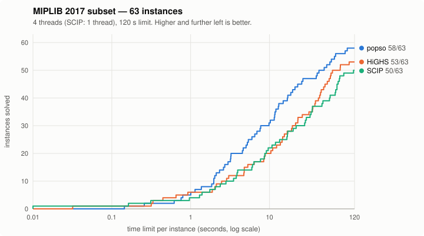

<p align="center"></p>

# popso

**popso** (Polkowski's Optimization Solver) is an open-source solver for **mixed-integer linear programs (MILP)** and **linear programs
(LP)**. It is written from scratch in C++20 using only the standard library.

This is a fun side project by [Marcin Polkowski](https://marcinpolkowski.com). The goal is
a fully open-source solver that holds its own against the best solvers on real
problems. It is built with heavy use of AI coding agents. More problem classes are planned.



On a 63-instance [MIPLIB 2017](https://miplib.zib.de) subset it currently solves more
instances, and is faster overall, than the open-source solvers HiGHS and SCIP:

| solver | solved | shifted geomean (s) |
|---|---|---|
| popso | 59/63 | 13.2 |
| HiGHS 1.15 | 53/63 | 18.9 |
| SCIP 10 | 50/63 | 21.3 |

These are single-machine numbers with caveats. See **[BENCHMARKS.md](BENCHMARKS.md)** for the
setup, per-instance results and the generated benchmark families, and
**[CHANGELOG.md](CHANGELOG.md)** for what each version can do.

## Build

You need CMake ≥ 3.20 and a C++20 compiler (clang, gcc or MSVC). No other dependencies.

```sh
cmake -S . -B build -DCMAKE_BUILD_TYPE=Release -DPOPSO_BUILD_TESTS=ON
cmake --build build -j 4
./build/popso_tests            # unit tests
```

The solver is developed and benchmarked on macOS (Apple silicon). Linux and Windows builds
are intended but are not yet tested regularly.

## Usage

```sh
./build/popso model.mps --sol model.sol --time-limit 60 --threads 4
```

The solver reads a model in MPS format (free or fixed) and prints a summary:

```
Status: OPTIMAL
Objective: 12574
Bound: 12574
Gap: 0.0000%
Nodes: 1
Time: 0.003s
```

With `--sol` it also writes the solution as a plain `name value` file:

```
# Solution for model knapsack_small_1
# Status = OPTIMAL
# Objective value = 12574
x0 0
x1 1
...
```

| option | meaning |
|---|---|
| `--sol <file>` | write the solution file |
| `--time-limit <sec>` | wall-clock time limit (default: none) |
| `--threads <n>` | number of threads (0 = all cores, the default) |
| `--gap <rel>` | relative optimality gap at which to stop (default 1e-4) |
| `--deterministic` | reproducible parallel search (slower; the default is opportunistic) |
| `--seed <n>` | random seed |
| `--racing <k>` | run k differently seeded searches at the same time |
| `--mem-limit <MB>` | approximate memory cap for the search tree (default 4096) |
| `--node-limit <n>` | stop after n branch-and-bound nodes |
| `--no-presolve` | disable presolve |
| `--verbosity <0-3>` | 0 silent, 1 summary (default), 2 progress, 3 debug |
| `--version` | print the version |

## What's inside

- **LP:** bounded dual simplex with hyper-sparse LU factorization, Forrest–Tomlin updates and
  dual steepest-edge pricing, plus a primal simplex for cleanup.
- **Presolve:** singleton rows and columns, bound and coefficient tightening, parallel rows and
  columns, dominated columns, aggregation and substitution, probing and clique merging, with
  full postsolve.
- **Cutting planes:**
  - Gomory mixed-integer cuts;
  - c-MIR cuts on aggregated rows;
  - lifted knapsack covers;
  - clique, implied-bound and zero-half cuts;
  - tableau cuts at tree nodes;
  - a dynamic cut pool.
- **Primal heuristics:**
  - simple rounding, diving and local search;
  - the feasibility pump and feasibility jump;
  - large-neighbourhood sub-MIPs: RINS, RENS and crossover.
- **Branch-and-bound:**
  - reliability branching on pseudocosts with strong branching;
  - node-level domain propagation and conflict analysis;
  - reduced-cost fixing;
  - symmetry handling (orbital fixing, orbitopes);
  - root and in-tree restarts.
- **Parallelism:** multithreaded tree search, either opportunistic or fully deterministic
  (`--deterministic` gives the same result on every run with the same thread count).
- **Robustness:** every result is checked against reference solvers. The search tree's
  memory use is bounded. A numerical failure in a node LP is recovered from instead of
  dropping that part of the tree.

## Current limitations

- **Problem classes:** LP and MILP only. No quadratic objectives or constraints, no general
  nonlinear constraints.
- **Model features:** no SOS constraints, indicator constraints, or semi-continuous or
  semi-integer variables.
- **Input and interfaces:**
  - MPS input only; no LP-format reader.
  - There is no library API, no language bindings and no callbacks; it is command line only.
  - You cannot pass a starting solution.
- **LP algorithms:** dual simplex only. There is no barrier or interior-point method, so very
  large LPs are slow.
- **Maturity:** this is young software. It is tuned on a limited benchmark set, and
  performance varies from instance to instance and with the random seed. Expect rough edges.

## Repository layout

```
src/milp/      the solver: core/ io/ lp/ presolve/ cuts/ heuristics/ search/ solver/
apps/          command-line front end
tests/         unit tests (own small harness, standard library only)
benchmarks/    instance generators, reference results, benchmark runner (Python)
docs/          plots
```

## License

Apache License 2.0 — see [LICENSE](LICENSE). Copyright 2026 Marcin Polkowski.

## Contact

Questions, ideas or interesting models to try? Get in touch via
[marcinpolkowski.com](https://marcinpolkowski.com).
